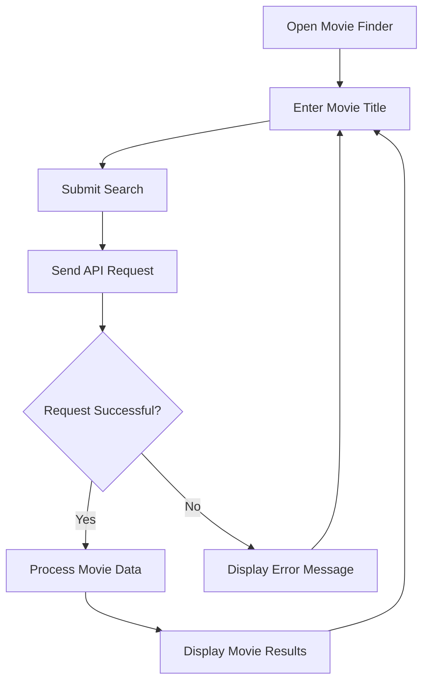

# TASK: Create a Professional GitHub README.md for Movie Finder

Act as a senior technical writer, GitHub repository specialist, and open-source documentation expert.

Create a visually attractive, professional, and comprehensive `README.md` for my **Movie Finder** project, based on the provided website screenshot and the four existing project screenshots.

## IMPORTANT REQUIREMENTS

* Generate **only `README.md`**.
* Do not create or modify `index.html`, `styles.css`, `script.js`, or any other application source files.
* Include all four screenshots in the README.
* Preserve the screenshot filenames exactly as provided.
* Explain the project, its features, technologies, workflow, API integration, installation, and usage.
* Use GitHub-compatible Markdown and HTML.
* Ensure the screenshots render as actual images, not as displayed file paths or code.
* Make the README ready to paste into my existing GitHub repository.

---

## 1. PROJECT INFORMATION

**Project Name:** Movie Finder

**Developer:** Yash Gunjal

**GitHub Username:** YashGunjal9

**Project Description:**

Movie Finder is a web application designed to help users search for movies by title through a simple, dark-themed search interface.

The website includes a movie search field and a blue Search Movies button. When users search for movies, the application is intended to retrieve and display matching movie information.

**Technology Stack:**

* HTML5
* CSS3
* JavaScript
* OMDb API, if confirmed by the existing implementation

Do not claim that the project uses Bootstrap or another framework unless the actual source code confirms it.

**GitHub Profile:**

https://github.com/YashGunjal9

Use the actual repository URL if it is available. Do not invent a repository URL.

---

## 2. EXISTING SCREENSHOTS

The project has a folder named `Screenshots` containing these four image files.

**Preserve these filenames exactly.**

### Screenshot 1

Filename:

`Search Bar.png`

Relative path:

`Screenshots/Search Bar.png`

Description:

The initial Movie Finder interface featuring the dark navy background, movie clapperboard icon, title, subtitle, search input, and Search Movies button.

### Screenshot 2

Filename:

`Searched Movie 1.png`

Relative path:

`Screenshots/Searched Movie 1.png`

Description:

A screenshot demonstrating the first movie search result.

### Screenshot 3

Filename:

`Searched Movie 2.png`

Relative path:

`Screenshots/Searched Movie 2.png`

Description:

A screenshot demonstrating another movie search result.

### Screenshot 4

Filename:

`Searched Movie 3.png`

Relative path:

`Screenshots/Searched Movie 3.png`

Description:

A screenshot demonstrating multiple movie results.

Do not rename, regenerate, or replace these images.

Do not invent additional screenshots.

---

## 3. README VISUAL STYLE

Create a modern README inspired by professional open-source GitHub repositories.

Use:

* A centered title and subtitle.
* A movie clapperboard emoji.
* Technology badges.
* Clear section headings.
* A concise project overview.
* An attractive screenshot gallery.
* A workflow diagram.
* A technology table.
* Installation instructions.
* API documentation.
* Developer information.
* A license section.

Use a visual identity inspired by the website's dark navy background and blue search button.

Keep the README easy to navigate and avoid excessive emojis or unnecessary text.

---

## 4. HEADER SECTION

Create a centered header using GitHub-compatible Markdown and HTML.

Include:

# 🎬 Movie Finder

### Search for your favorite movies

Add this short description:

"A movie search application with a clean dark-themed interface for exploring movie information."

Add Shields.io badges for:

* HTML5
* CSS3
* JavaScript
* OMDb API, only if confirmed

Example badge styles:

* HTML5: orange
* CSS3: blue
* JavaScript: yellow
* API: purple

Use appropriate logos and ensure that the badge URLs are valid.

Do not fabricate GitHub star counts, fork counts, download statistics, or deployment statuses.

---

## 5. ABOUT THE PROJECT

Create a section titled:

## 📖 About the Project

Explain that Movie Finder provides a simple interface for searching for movies by name.

Describe the visible interface:

* Movie Finder heading.
* Movie search input.
* Search Movies button.
* Dark navy background.
* Blue action button.

Explain that JavaScript can communicate with the configured movie database API to retrieve matching results.

Do not claim unverified features.

---

## 6. FEATURES

Create a section titled:

## ✨ Features

Document the features supported by the actual application.

Potential features include:

* 🎬 Search movies by title.
* 🔎 Simple search interface.
* 🌙 Dark-themed user interface.
* 🔵 Blue Search Movies button.
* ⚡ API-based movie search.
* 🖼️ Movie poster display, if implemented.
* 📅 Release year information, if implemented.
* ⭐ Movie ratings, if implemented.
* 📝 Movie descriptions, if implemented.
* 📱 Responsive layout, if implemented.
* ⚠️ Error handling, if implemented.

Do not claim that every feature is implemented unless the source code confirms it.

If the source code is unavailable, describe unverified features conditionally rather than presenting them as established facts.

---

## 7. PROJECT SCREENSHOTS — ALL FOUR IMAGES REQUIRED

Create a prominent section titled:

## 🖥️ Project Screenshots

**This section is essential. Include all four existing screenshots.**

Each screenshot must have:

* A descriptive heading.
* A brief explanation.
* A Markdown image reference.
* Appropriate alternative text.

### Screenshot 1: Movie Search Interface

Heading:

### 🔍 1. Movie Search Interface

Description:

The initial interface features a dark navy background, Movie Finder heading, subtitle, search field, and blue Search Movies button.

Use this exact Markdown image reference:


### Screenshot 2: First Movie Search Result

Heading:

### 🎬 2. First Movie Search Result

Description:

This screenshot demonstrates the application after a movie search.

Use this exact Markdown image reference:


### Screenshot 3: Second Movie Search Result

Heading:

### 🍿 3. Second Movie Search Result

Description:

This screenshot demonstrates another movie search result.

Use this exact Markdown image reference:


### Screenshot 4: Multiple Movie Results

Heading:

### 🎥 4. Multiple Movie Results

Description:

This screenshot demonstrates the application displaying multiple movie results.

Use this exact Markdown image reference:


### Screenshot rendering requirements

* Use relative paths from the repository root.
* Preserve the exact image filenames.
* Use `%20` for spaces in Markdown image paths.
* Do not wrap image references inside triple-backtick code blocks in the final README.
* Do not display the image paths as ordinary text instead of rendering the images.
* Do not invent a different folder name.
* Ensure all four images are included in the final README.

If the screenshots have not been uploaded to GitHub, mention that they must be uploaded to the repository's `Screenshots` folder before they can render.

---

## 8. HOW IT WORKS

Create a section titled:

## ⚙️ How It Works

Explain the intended workflow:

1. The user opens the Movie Finder application.
2. The user enters a movie title.
3. The user clicks Search Movies or presses Enter, if supported.
4. JavaScript processes the search request.
5. The application sends a request to its configured movie database API.
6. The API returns movie information.
7. JavaScript processes the response.
8. The application displays the available results.
9. The user can search for another movie.

Do not claim that every interaction is implemented unless confirmed by the source code.

---

## 9. WORKFLOW DIAGRAM

Create a section titled:

## 🔄 Application Workflow

Use a GitHub-compatible Mermaid diagram.

Include this diagram directly in the README:



Add a short explanation of the data flow.

If the source code has not been inspected, describe this as the intended workflow.

---

## 10. TECHNOLOGIES USED

Create a professional Markdown table.

| Technology         | Purpose                                        |
| ------------------ | ---------------------------------------------- |
| HTML5              | Structures the web page                        |
| CSS3               | Provides styling and the dark-themed interface |
| JavaScript         | Handles user interactions and API requests     |
| Movie Database API | Provides movie information                     |

If the application uses OMDb, identify it by name.

Do not list frameworks, libraries, or services that are not actually used.

---

## 11. API DOCUMENTATION

Create a section titled:

## 🌐 API Integration

If the source code confirms that the project uses the OMDb API, document the following endpoint format:

`https://www.omdbapi.com/?apikey=YOUR_API_KEY&s=MOVIE_NAME`

Explain:

* `apikey` represents the API key.
* `s` specifies the movie search term.
* The API returns movie information in JSON format.

Official website:

https://www.omdbapi.com/

Explain that the exact API and endpoint depend on the project's implementation.

### API key security

* Never include a real API key in the README.
* Never include a real API key in screenshots.
* Use `YOUR_API_KEY` as a placeholder.
* Explain that frontend-only JavaScript cannot keep an API key secret.
* If API key protection is required, a secure backend or server-side proxy is needed.

If the application uses a different API, document that API instead.

Do not invent API integration details.

---

## 12. PROJECT STRUCTURE

Create a section titled:

## 📂 Project Structure

Use the following structure if it matches the repository:

```text
Movie-Finder/
├── index.html
├── styles.css
├── script.js
├── README.md
└── Screenshots/
    ├── Search Bar.png
    ├── Searched Movie 1.png
    ├── Searched Movie 2.png
    └── Searched Movie 3.png
```

Explain the purpose of each file:

* `index.html` — main page structure.
* `styles.css` — visual styling and responsive layout.
* `script.js` — search logic and API integration.
* `README.md` — project documentation.
* `Screenshots/` — four project screenshots.

If the actual repository uses different source filenames, adapt the structure accordingly.

Do not claim that a file exists unless it is present in the project.

---

## 13. INSTALLATION AND USAGE

Create a section titled:

## 🚀 Getting Started

### Prerequisites

* A modern web browser.
* Internet access for API requests.
* Visual Studio Code, optionally.
* An API key, if required by the configured API.

### Clone the repository

Use the actual repository URL if known.

Otherwise, provide a clearly marked placeholder:

```bash
git clone YOUR_REPOSITORY_URL
```

Navigate into the project directory:

```bash
cd Movie-Finder
```

### Run the application

Explain how to:

1. Open the project folder in Visual Studio Code.
2. Open `index.html` directly in a browser or use Live Server.
3. Enter a movie name.
4. Click Search Movies.
5. View the returned information.

Explain any required API configuration only when supported by the actual project.

Do not introduce npm or Node.js commands for a static application unless they are genuinely required.

---

## 14. LIVE DEMO

Create a section titled:

## 🌐 Live Demo

Explain that the project can be deployed using GitHub Pages if it is a compatible static website.

Official documentation:

https://docs.github.com/en/pages

Use a placeholder for the live demo URL until deployment is confirmed.

Do not invent a deployed website URL.

Do not claim that deployment has already happened.

---

## 15. FUTURE IMPROVEMENTS

Create a section titled:

## 🔮 Future Improvements

Suggest potential improvements such as:

* Movie search suggestions.
* Improved movie result cards.
* Movie poster previews.
* Detailed movie information.
* Genre filtering.
* Better loading and error states.
* Responsive mobile design improvements.
* Accessibility enhancements.

Clearly identify these as future ideas rather than existing features.

---

## 16. DEVELOPER INFORMATION

Create a section titled:

## 👨‍💻 Developer

**Yash Gunjal**

GitHub profile:

https://github.com/YashGunjal9

Use a clickable Markdown link to the GitHub profile.

Do not invent an email address, portfolio website, or other social media accounts.

---

## 17. LICENSE

Create a section titled:

## 📄 License

Do not claim that the project uses the MIT License or another license unless the repository contains the corresponding license file.

If no license file exists, state that licensing information has not yet been specified.

---

## 18. GITHUB REPOSITORY ABOUT SECTION

After generating the README content, separately recommend this repository description:

`A movie search web application built with HTML, CSS, and JavaScript using a movie database API.`

Recommend these GitHub topics:

* `movie-finder`
* `movie-search`
* `javascript`
* `html`
* `css`
* `movie-database-api`
* `web-development`

Recommend `omdb-api` only if the project actually uses OMDb.

Keep these recommendations outside the README content so I can add them manually to GitHub's About section.

---

## 19. FINAL OUTPUT REQUIREMENTS

Generate the complete contents of **one file only: `README.md`**.

The final README must:

* Include every required section.
* Include all four screenshot references.
* Preserve all screenshot filenames exactly.
* Use valid Markdown and GitHub-compatible HTML.
* Use correct relative image paths.
* Render the screenshots as actual images.
* Include a valid Mermaid workflow diagram.
* Describe the API accurately.
* Include installation and usage instructions.
* Include developer information.
* Avoid fabricated features, statistics, URLs, and deployment claims.
* Never expose API keys.
* Avoid unnecessary repetition.
* Not include instructions for creating the README as part of the README itself.
* Not wrap the entire README in a code block.
* Not create or modify any other files.

**The final result must be a complete, professional, ready-to-paste Movie Finder `README.md` that displays all four existing screenshots directly on GitHub.**
